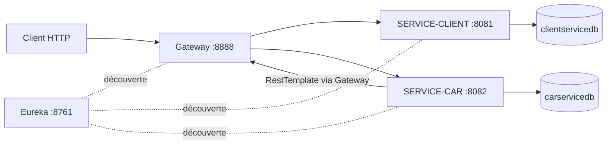

# TP20 — Microservices avec RestTemplate

Implémentation du [TP20 du cours Architecture Microservices](https://mliaedu.toubkalit.com/student/courses/7/labs/247). Le projet sépare Eureka, le service Client, le service Voiture et la Gateway en quatre modules Maven.



## Prérequis et compilation

- JDK 17 ou plus, Maven 3.9 ou plus.
- Ports libres : 8761, 8081, 8082 et 8888.
- MySQL pour la configuration par défaut. Définir `DB_USER` et `DB_PASSWORD` si nécessaire. Les bases sont créées par l'URL JDBC si le compte dispose des droits requis.

```powershell
mvn -B -ntp clean verify
```

Le profil `demo` utilise deux bases H2 en mémoire et permet d'exécuter le TP sans MySQL. Après la compilation, ouvrir quatre terminaux à la racine du projet et lancer dans cet ordre :

```powershell
java -jar eureka-server/target/eureka-server-1.0-SNAPSHOT.jar
java -jar service-client/target/service-client-1.0-SNAPSHOT.jar --spring.profiles.active=demo
java -jar service-car/target/service-car-1.0-SNAPSHOT.jar --spring.profiles.active=demo
java -jar api-gateway/target/api-gateway-1.0-SNAPSHOT.jar
```

Sans `--spring.profiles.active=demo`, les deux services utilisent MySQL. Le dashboard Eureka est à <http://localhost:8761/>. La Gateway crée ses routes à partir des noms de services enregistrés.

## Vérification manuelle

```powershell
$client = Invoke-RestMethod -Method Post -Uri http://localhost:8081/api/client -ContentType application/json -Body '{"nom":"Ahmed","age":30}'
$body = @{ brand='Toyota'; model='Corolla'; matricule='A-123'; clientId=$client.id } | ConvertTo-Json
$car = Invoke-RestMethod -Method Post -Uri http://localhost:8082/api/car -ContentType application/json -Body $body
Invoke-RestMethod "http://localhost:8888/SERVICE-CAR/api/car/$($car.id)"
```

Réponse attendue : voiture avec `client.nom` égal à `Ahmed`. Les routes principales sont `GET /api/client`, `GET /api/client/{id}`, `POST /api/client`, `GET /api/car`, `GET /api/car/{id}` et `POST /api/car`. Via la Gateway, préfixer les chemins par `http://localhost:8888/SERVICE-CLIENT` ou `http://localhost:8888/SERVICE-CAR`.

Le script suivant lance les quatre applications, crée les données, vérifie l'appel `RestTemplate` via la Gateway, puis arrête uniquement les processus qu'il a démarrés :

```powershell
./scripts/smoke-test.ps1
```

Les journaux du scénario sont dans `target/smoke-test/`.


## Choix techniques

- Spring Boot 3.5.15 et Spring Cloud 2025.0.3, compatibles avec Java 17. Le TP d'origine cite une ancienne version de Spring Cloud et mélange Gateway réactive et Spring MVC ; ce projet emploie Gateway WebFlux.
- `clientId` est stocké dans la base des voitures. Le client distant est ajouté à la réponse avec `@Transient` ; aucune relation JPA ne traverse les bases.
- Le DTO client emploie `nom` et `Float age`, conformément au JSON du service Client. Le document du TP emploie aussi `name` et `Integer age` dans un passage, ce qui empêcherait l'enrichissement correct.
- En cas d'indisponibilité du service Client, la voiture reste retournée avec `client: null`, conformément au comportement présenté dans le TP.

## Résultat vérifié

Le 17 novembre 2026, `mvn -o -B -ntp verify` a réussi et les tests des deux services ont passé. Le script de vérification a renvoyé :

```json
{"id":1,"brand":"Toyota","model":"Corolla","matricule":"A-123","clientId":1,"client":{"id":1,"nom":"Ahmed","age":30.0}}
```
